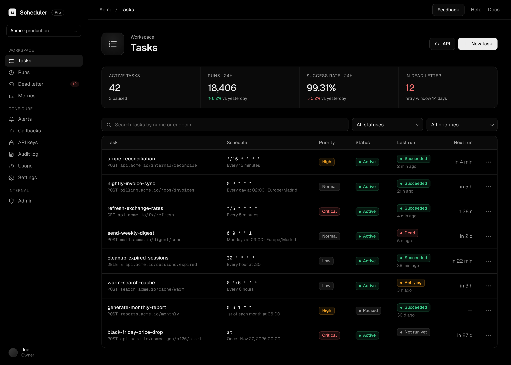
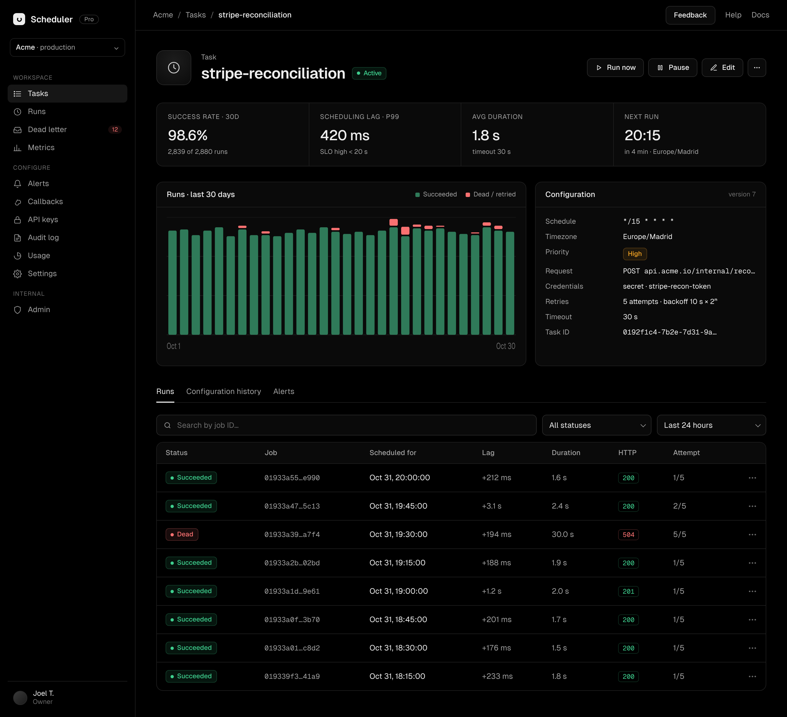
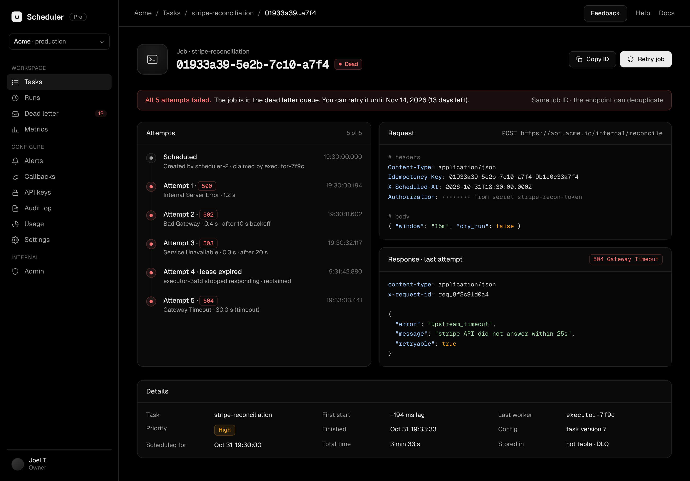
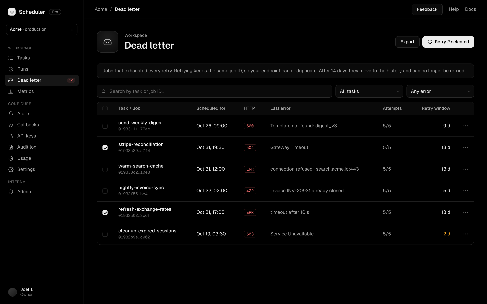
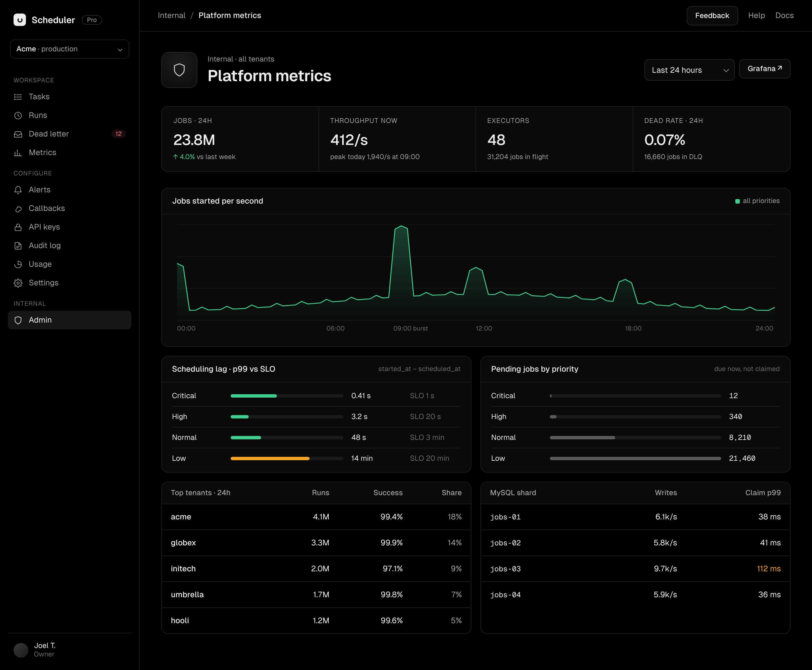

# distributed-scheduler-front

The web dashboard for the distributed job scheduler, a service for scheduling HTTP calls to your own endpoints (once, at a given time, or on a cron expression) with priorities, automatic retries and a dead letter queue.

From this dashboard you will be able to create and manage tasks, follow their runs, inspect why a job failed and retry the ones that ended up in the dead letter queue.

The screens below are mockups of the target design, not screenshots of the running app: anything the backend does not support yet stays behind [src/lib/features.ts](src/lib/features.ts). The full spec is in [plan/SPEC.md](plan/SPEC.md).

## Run

```bash
npm install
npm run dev:mocks   # every screen, served by in-browser mocks, no services needed
```

To run against the real services instead, with seeded data and no login (needs Docker, Go and the backend repo next to this one):

```bash
./local-env/env.sh up       # MySQL, Cassandra, migrations, both services, seed data, dashboard
./local-env/env.sh seed     # rewrite the jobs, relative to now
./local-env/env.sh status
./local-env/env.sh stop     # stop everything, keep the data
./local-env/env.sh down     # stop everything and delete the data
```

The dashboard is at http://localhost:3000. The first `up` creates a local secret and a test JWT (`local-env/.env`, not committed) that lasts until 2100; `next dev` uses it when there is no session cookie, and production builds ignore it.

The scheduler and the executor do not exist yet, so tasks never fire: jobs only come from the seed, and `next_run_at` falls into the past until the next `down` and `up`.

`npm run build`, `npm run lint` and `npm run typecheck` run the checks.

## How it will look

### Tasks

Every scheduled task, with its schedule, priority, status and next run.



### Task detail

A task's configuration, performance and run history.



### Job detail

One execution in depth: each attempt, the request sent and the response received.



### Dead letter

Jobs that exhausted every retry, ready to be reviewed and retried.



### Admin metrics

Internal platform view: throughput, scheduling lag, pending jobs, tenants and shards.


