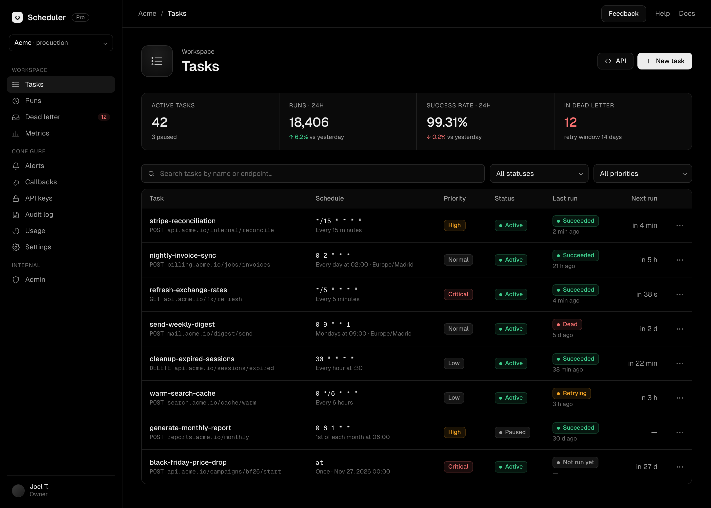
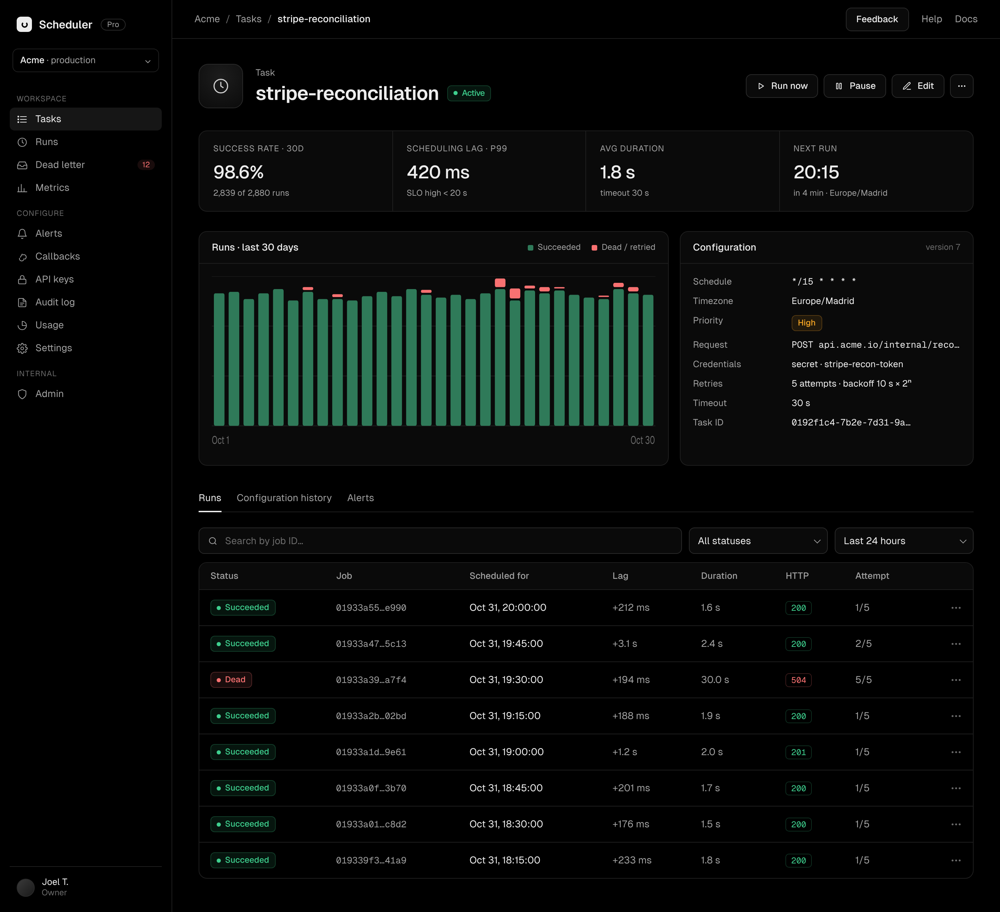
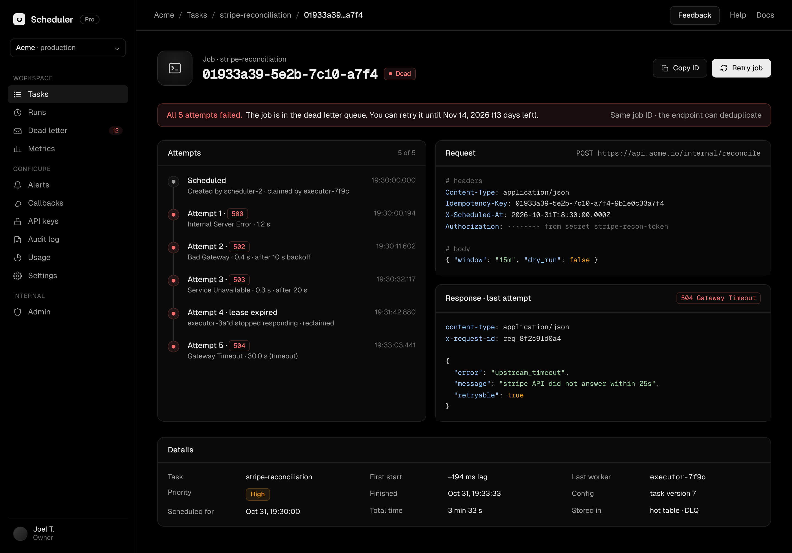
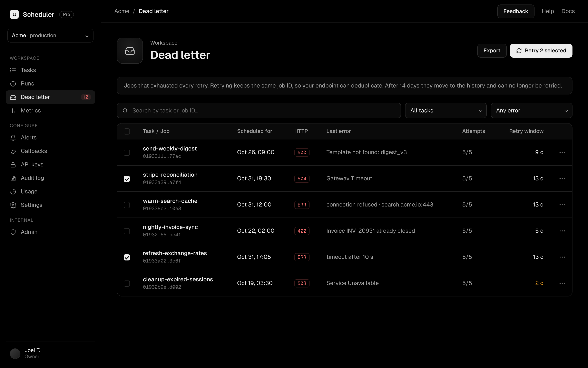
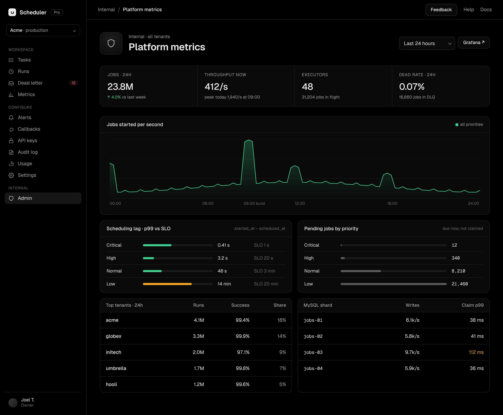

# Frontend spec: scheduler dashboard

Dark dashboard for the distributed job scheduler, in the visual language of Vercel and Resend. This spec covers the stack, architecture, design rules, what each screen can already show with the **Task Service** and **Job Service**, and what stays pending until new backend work exists.

Mockups (source of truth for layout and style): `docs/mockups/`

| Screen | Mockup |
|---|---|
| Tasks |  |
| Task detail |  |
| Job detail |  |
| Dead letter |  |
| Admin metrics |  |

`docs/mockups/reference-tokens.css` is the CSS used to render the mockups. Port its tokens; do not copy its markup.

---

## 1. Stack

| Concern | Choice | Why |
|---|---|---|
| Framework | **Next.js (App Router) + TypeScript (strict)** | Server components for first load, route handlers as a thin BFF that keeps the JWT out of the browser |
| Styling | **Tailwind CSS** with design tokens as CSS variables | Tokens in one place, utilities everywhere else |
| UI primitives | **Radix UI** (via shadcn/ui, copied into `components/ui`) | Accessible menus, dialogs, tooltips, tabs out of the box; we own the styling |
| Data fetching | **TanStack Query** | Cache, polling for running jobs, optimistic pause/resume, cursor pagination |
| Validation / API types | **zod** | Parse every API response; one schema per DTO |
| Font | **Geist Sans + Geist Mono** (`geist` package) | Same as the mockups |
| Icons | **lucide-react** | Same stroke style as the mockups |
| Toasts | **sonner** | Stacked toasts, Vercel-like behaviour |
| Cron text | **cronstrue** | `*/15 * * * *` → "Every 15 minutes" |
| Dates | **date-fns** + **date-fns-tz** | Formatting in the task timezone and the user locale |
| Charts (later) | **Recharts** | Only when the metrics service exists |

Pin exact versions in `package.json` when installing. No CSS-in-JS, no component library with its own theme (MUI, Chakra...).

---

## 2. Architecture

```text
frontend/
  app/
    (auth)/login/page.tsx            placeholder until the auth service exists
    (dashboard)/layout.tsx           sidebar + top bar
    (dashboard)/tasks/page.tsx
    (dashboard)/tasks/new/page.tsx   create form (not mocked yet, same style)
    (dashboard)/tasks/[taskId]/page.tsx
    (dashboard)/tasks/[taskId]/edit/page.tsx
    (dashboard)/jobs/[jobId]/page.tsx
    (dashboard)/dead-letter/page.tsx
    (dashboard)/admin/page.tsx       "coming soon" shell
    api/[...path]/route.ts           BFF proxy to task-service / job-service
  src/
    features/
      tasks/   api.ts  schemas.ts  queries.ts  components/
      jobs/    api.ts  schemas.ts  queries.ts  components/
    components/
      ui/      button, badge, table, stat-card, code-block, timeline, tooltip, dropdown, dialog, skeleton, copy-button...
      layout/  sidebar, topbar, page-header
    lib/
      http.ts       typed fetch, error mapping, Idempotency-Key, If-Match
      features.ts   feature flags for everything that is pending
      format.ts     dates, durations, ids, numbers
      status.ts     status -> badge mapping (single source)
    styles/
      tokens.css    colors, radii, shadows, motion
```

Rules:
- **Feature folders own their API.** `features/tasks/api.ts` is the only place that knows Task Service URLs. Components never call `fetch` directly.
- **One zod schema per DTO.** API responses are parsed at the boundary; components receive typed domain objects.
- **BFF proxy.** The browser calls `/api/...`; the route handler adds `Authorization: Bearer <jwt>` from an httpOnly cookie and forwards to the right service. Service URLs come from env vars (`TASK_SERVICE_URL`, `JOB_SERVICE_URL`).
- **Server components for the first render** of lists and details; TanStack Query takes over on the client (hydrate with the server data).
- **Feature flags for pending features.** Everything in section 6 reads from `lib/features.ts`; turning a feature on is a one-line change.

### API client rules (`lib/http.ts`)
- `POST /tasks` sends an `Idempotency-Key` generated **once per form submission** (`crypto.randomUUID()`), reused if the request is retried.
- `PATCH /tasks/{id}` sends `If-Match: <version>` from the loaded task.
- Error mapping:

| Status | UI behaviour |
|---|---|
| 400 (validation) | Errors next to their fields, focus the first one |
| 404 | Not-found state for the page |
| 409 (version conflict) | Toast "This task was changed elsewhere" + action "Reload" |
| 409 (retry on a non-dead job) | Toast "Job is no longer in the dead letter" and refetch |
| 422 (idempotency mismatch) | Toast with the error; keep the form |
| 5xx / network | Toast "Something went wrong" + "Retry" |

---

## 3. Design rules

### Tokens
Port these from `reference-tokens.css` into `styles/tokens.css` and map them in the Tailwind config:

| Token | Value | Use |
|---|---|---|
| `--bg` | `#000` | page |
| `--surface` | `#0a0a0a` | cards, table headers, inputs |
| `--surface-2` | `#111` | hover, nested |
| `--border` | `#1f1f1f` | default borders and row separators |
| `--border-2` | `#2a2a2a` | inputs, buttons, stronger borders |
| `--text` | `#ededed` | primary text |
| `--muted` | `#a1a1a1` | secondary text, labels |
| `--subtle` | `#6b6b6b` | tertiary text, placeholders |
| `--green` / `--red` / `--amber` / `--blue` | `#3ecf8e` / `#f87171` / `#f5a524` / `#52a8ff` | status colors; backgrounds at ~10% alpha, borders at ~22% |

Radii: 6px badges, 8px buttons and inputs, 12px cards and tables, 14px page tile. No shadows on dark surfaces; separation comes from borders.

### Typography
- Geist Sans 14px base. Page title 28px / 600 / -0.02em. Stat values 26px / 500. Section titles 16px / 500. Labels 12px uppercase +0.05em in `--muted`.
- Geist Mono for IDs, cron expressions, URLs, headers, JSON, HTTP codes.
- `font-variant-numeric: tabular-nums` on every number column and stat.

### Components (one implementation each)
- **Page header:** 64px icon tile + eyebrow + title (+ status badge) on the left, actions on the right.
- **Stat row:** 4 cells in one bordered card, vertical dividers.
- **Table:** bordered, header on `--surface`, rows separated by `--border`, row hover `--surface-2`, whole row clickable (`<Link>`), actions in a trailing `•••` menu.
- **Badge:** dot + label for states; plain (no dot) for priorities.
- **Code block:** Geist Mono 12.5px on `#070707`, with a copy button.
- **Timeline:** dot per step, vertical connector, timestamp right-aligned in mono.

### Status mapping (`lib/status.ts`, single source)

| Domain value | Label | Color |
|---|---|---|
| task `active` | Active | green |
| task `paused` | Paused | gray |
| job `pending`, attempt = 0 | Queued | gray |
| job `pending`, attempt > 0 | Retrying | amber |
| job `running` | Running | blue, pulsing dot |
| job `succeeded` | Succeeded | green |
| job `dead` | Dead | red |
| priority `critical` / `high` / `normal` / `low` | same | red / amber / gray / gray |
| HTTP 2xx / 3xx / 4xx-5xx / no response | code / code / code / `ERR` | green / gray / red / red |

### Formatting (`lib/format.ts`)
- Absolute times in the **user's locale and timezone**; full UTC timestamp in a tooltip.
- Schedules are shown **in the task timezone** ("Every day at 02:00 · Europe/Madrid").
- Relative times for recent events ("2 min ago", "in 4 min"); absolute after 7 days.
- Durations: `ms` under 1 s, `s` with one decimal under 1 min, then `m s`.
- Scheduling lag = `started_at − scheduled_at`, prefixed with `+`.
- IDs truncated in the middle (`01933a39…a7f4`) with a copy button; full ID on hover.

---

## 4. Motion and interactions (Vercel-style)

Follow the Vercel Web Interface Guidelines (vercel.com/design/guidelines). The concrete rules for this app:

**General**
- Animate only `opacity` and `transform`. Never `transition: all`; list the properties.
- Durations: 120–150 ms for hover/press, 150–200 ms for menus/tooltips/dialogs. Easing `cubic-bezier(0.2, 0, 0, 1)` for entering, `ease-in` for leaving.
- Honor `prefers-reduced-motion`: replace movement with a plain fade or nothing.
- Visible focus ring on every focusable element with `:focus-visible` (2px ring in `--blue`, offset 2px from the background).

**Buttons**
- Hover: background one step lighter (`--surface` → `--surface-2`; primary `#ededed` → `#fff`). Press: `scale(0.98)`.
- Loading: keep the label, add a spinner, end the label with an ellipsis ("Retrying…"). Disable only while the request is in flight.
- Icon-only buttons have an `aria-label` and a tooltip.

**Menus, tooltips, dialogs**
- Dropdowns: fade + 4px `translateY`, origin at the trigger.
- Tooltips: first one in a group after ~400 ms, neighbours with no delay.
- Dialogs: overlay fade, content fade + `scale(0.96 → 1)`.
- Menu items that open a further step end with an ellipsis ("Delete task…").

**Data**
- Skeletons that mirror the final layout exactly (same rows, same heights). Show after ~200 ms, keep at least ~400 ms to avoid flicker.
- **Optimistic updates** for pause/resume and retry: update the badge at once, roll back with a toast on error.
- Destructive actions (delete task) need a confirmation dialog that names the task.
- Copy buttons swap the icon to a check for ~1.5 s.
- Running jobs: pulsing blue dot; the task detail page polls its jobs every 10 s **only while the tab is visible**.
- Toasts (sonner) bottom-right, stacked, with `aria-live="polite"`.

**Keyboard**
- Every flow works with the keyboard. Table rows are links, so Enter opens them.
- `/` focuses the search box on list pages.

---

## 5. Screens: what works today and what does not

Legend: ✅ available with today's endpoints · ⚠️ possible with a workaround or a small change to an existing service · ❌ needs new backend work (see section 6)

Today's endpoints:

```text
Task Service                                  Job Service
POST   /tasks          (Idempotency-Key)      GET  /jobs/{id}
GET    /tasks          ?cursor&limit          GET  /tasks/{id}/jobs   ?cursor&limit
GET    /tasks/{id}                            GET  /jobs?status=dead  ?cursor&limit
PATCH  /tasks/{id}     (If-Match)             POST /jobs/{id}/retry
POST   /tasks/{id}/pause
POST   /tasks/{id}/resume
DELETE /tasks/{id}
```

### 5.1 Tasks (`/tasks`)

| Element | Source | State |
|---|---|---|
| Table: name, endpoint, cron + human text, priority, status, next run | `GET /tasks` (+ cronstrue for the text) | ✅ |
| Pagination | cursor of `GET /tasks`, "Load more" button | ✅ |
| Row menu: pause / resume / delete | `POST .../pause`, `.../resume`, `DELETE` | ✅ |
| "New task" button → create form | `POST /tasks` | ✅ (form to build, same style) |
| "API" button | link to docs, no backend | ✅ |
| "Last run" column (status + when) | not in `GET /tasks`; would need one `GET /tasks/{id}/jobs?limit=1` per row | ⚠️ N+1 for now, backend change later |
| Search by name / endpoint | no server filter; only client-side over loaded rows | ⚠️ needs `?q=` |
| Filters: status, priority | no server filter | ⚠️ needs `?status=&priority=` |
| Stat: active tasks / paused | no count endpoint | ⚠️ needs counts |
| Stat: runs 24h, success rate 24h | — | ❌ metrics service |
| Stat: in dead letter | `GET /jobs?status=dead` has no total | ⚠️ needs a count |

### 5.2 Task detail (`/tasks/[taskId]`)

| Element | Source | State |
|---|---|---|
| Header: name, status badge | `GET /tasks/{id}` | ✅ |
| Pause / Resume (optimistic) | `POST .../pause`, `.../resume` | ✅ |
| Edit → edit form | `PATCH /tasks/{id}` with `If-Match` | ✅ |
| `•••` → Delete task… (confirm dialog) | `DELETE /tasks/{id}` | ✅ |
| Configuration card (schedule, tz, priority, request, credentials name, retries, timeout, ID, version) | `GET /tasks/{id}` | ✅ |
| Stat: next run | `next_run_at` | ✅ |
| Runs tab: status, job ID, scheduled for, lag, duration, HTTP, attempt | `GET /tasks/{id}/jobs`; lag and duration computed | ✅ |
| Runs pagination + polling | cursor + refetch every 10 s | ✅ |
| Search by job ID | exact ID → `GET /jobs/{id}` | ✅ |
| Filter runs by status / time range | not supported by the endpoint | ⚠️ needs `?status=&from=&to=` |
| "Run now" | no endpoint | ❌ `POST /tasks/{id}/run` (needs to create a job) |
| Stats: success rate 30d, scheduling lag p99, avg duration | — | ❌ metrics service |
| Chart: runs last 30 days | — | ❌ metrics service |
| Tab "Configuration history" | — | ❌ audit log / task versions |
| Tab "Alerts" | — | ❌ alerts service |

### 5.3 Job detail (`/jobs/[jobId]`)

| Element | Source | State |
|---|---|---|
| Header: job ID, status, copy ID | `GET /jobs/{id}` | ✅ |
| "Retry job" (dead only, optimistic) | `POST /jobs/{id}/retry` | ✅ |
| Request panel: method, URL, headers, body, `Idempotency-Key` (= job ID), credentials shown as secret name | job config snapshot | ✅ for jobs in the hot table |
| Response panel: HTTP code, error, body (truncated) | last attempt result | ✅ |
| Details: priority, scheduled for, finished, attempts `n/max` | `GET /jobs/{id}` | ✅ |
| Details: task name | job only has `task_id` → extra `GET /tasks/{id}` | ✅ two calls |
| Banner "you can retry until …" | `finished_at` + DLQ retention (14 d constant in the client) | ⚠️ better: API returns `retry_until` |
| Request panel for **archived** jobs | Cassandra `job_history` does not store the request | ⚠️ show "Request not retained for archived jobs", or store it |
| "Stored in" (hot / history) | not returned | ⚠️ API returns `source` |
| Attempts timeline (one row per attempt) | only the **last** attempt is stored | ❌ `job_attempts` table written by the executor; until then show a single "Last attempt" row |
| Response headers | not stored | ❌ executor change |
| First start lag, total time | `started_at` is overwritten on every claim | ⚠️ add `first_started_at` |
| Last worker | worker is cleared when the job finishes | ⚠️ keep `worker_name` on terminal jobs |
| Config version | job does not store the task version | ⚠️ add `task_version` to the job |

### 5.4 Dead letter (`/dead-letter`)

| Element | Source | State |
|---|---|---|
| Table: job ID, scheduled for, HTTP, last error, attempts | `GET /jobs?status=dead` | ✅ |
| Task name per row | join in the client with tasks already cached | ✅ |
| Retry one / "Retry N selected" | `POST /jobs/{id}/retry` in a loop, one toast with the summary | ✅ (bulk endpoint later) |
| Search by job ID | `GET /jobs/{id}` | ✅ |
| Export | CSV of the loaded rows, client-side | ✅ |
| Retry window column | `finished_at` + 14 d | ⚠️ same as 5.3 |
| Filters: task, error type | not supported | ⚠️ needs `?task_id=` |
| Sidebar badge with the count | no total | ⚠️ needs a count |

### 5.5 Admin metrics (`/admin`)

Everything on this page depends on new backend work: ❌ metrics service + ❌ admin role in the JWT. Ship the route as a "coming soon" shell behind a flag.

### 5.6 Shell (sidebar, top bar)

| Element | State |
|---|---|
| Tasks, Dead letter | ✅ |
| Runs (all jobs across tasks) | ❌ no tenant-wide jobs listing |
| Metrics | ❌ metrics service |
| Alerts, Callbacks, API keys, Audit log, Usage, Settings | ❌ new services |
| Workspace switcher, user menu, login | ❌ auth service (users, tenants, JWT issuing) |

---

## 6. Pending work (to-do)

### How pending features look in the UI
- **Nav items:** visible, `--subtle` color, small "Soon" pill, not clickable, tooltip "Not available yet".
- **Buttons:** rendered disabled with a tooltip explaining what is missing ("Run now needs the scheduler API").
- **Stat cards:** value `—` in `--subtle`, label kept, tooltip "Metrics coming soon".
- **Charts and tabs:** empty state inside the card with one line of text; no fake data.
- All of it driven by `lib/features.ts`:

```ts
export const features = {
  metrics: false,        // stat cards, charts, admin page
  runNow: false,         // "Run now" button
  attemptsTimeline: false,
  lastRunColumn: false,  // until GET /tasks returns it (or accept the N+1)
  serverFilters: false,  // search and filters on lists
  counts: false,         // stat counts + sidebar badge
  globalRuns: false,
  alerts: false,
  callbacks: false,
  apiKeys: false,
  auditLog: false,
  usage: false,
  auth: false,           // login, workspace switcher, user menu
} as const
```

### Small changes to existing services
- [ ] Task Service: `GET /tasks?q=&status=&priority=`
- [ ] Task Service: counts per status (`GET /tasks/stats` or `total` in the list)
- [ ] Task Service or Job Service: last run per task (batch `GET /jobs/last?task_ids=…` or a summary in `GET /tasks`)
- [ ] Job Service: `GET /tasks/{id}/jobs?status=&from=&to=`
- [ ] Job Service: `GET /jobs?status=dead&task_id=` and a total
- [ ] Job Service: return `retry_until` and `source` (hot | history)
- [ ] Jobs table: `first_started_at`, keep `worker_name` on terminal jobs, `task_version`
- [ ] Decide: store the request snapshot in Cassandra, or show "not retained" for archived jobs

### New backend work
- [ ] **Auth service:** users, tenants, roles (admin), JWT issuing. Until then: a dev JWT signed with the shared secret, set as a cookie by a dev-only route.
- [ ] **Run now:** `POST /tasks/{id}/run` that inserts a one-off job without touching the cron schedule.
- [ ] **Executor:** `job_attempts` table (one row per attempt, with response headers).
- [ ] **Metrics service:** runs and success rate per task and tenant, scheduling lag p99 per priority, throughput, pending by priority, per-shard load.
- [ ] **Tenant-wide runs listing** (sidebar "Runs").
- [ ] **Alerts, callbacks, API keys, audit log / task versions, usage.**

---

## 7. Definition of done for each screen
- Matches the mockup at 1440 px; usable down to 1024 px (sidebar collapses to icons below that).
- Loading (skeleton), empty, error, and not-found states exist.
- Every pending element follows section 6 and is driven by a flag.
- Keyboard-only walkthrough works; focus ring always visible; reduced motion respected.
- No `fetch` outside `features/*/api.ts`; every response parsed with zod.
